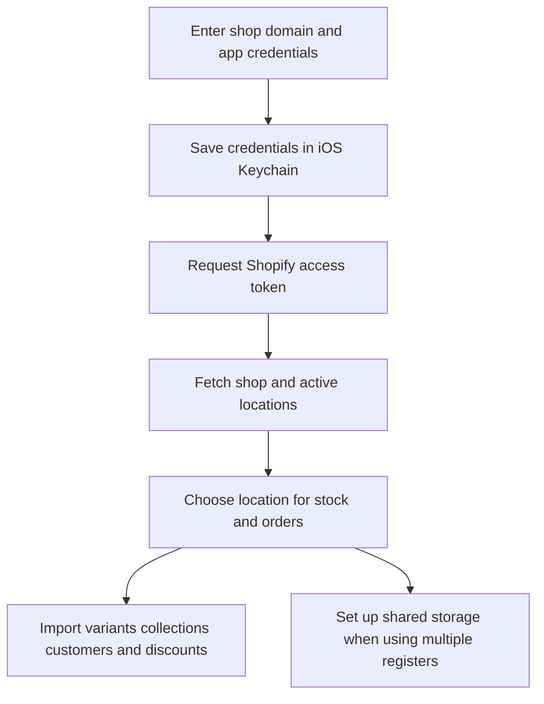

Open **More ▸ Settings ▸ Shopify** to connect the register to a Shopify store, choose the stock location and import its catalogue.

## Basic

### Connect a shop
1. Enter the **Store domain**, **Client ID (Dev Dashboard app)** and **Client secret**.
2. Tap **Save & test connection**. The register checks the credentials with Shopify and shows the shop name and reported scopes if successful.
3. Choose a **Location (stock & orders)** if more than one active location is available.
4. Tap **Import from Shopify** to load variants, collections, customers and discounts.

The domain can be entered as `yourshop.myshopify.com`; the screen normalises it. The Client ID and Client secret are from your Shopify Dev Dashboard app. They are stored in the iOS Keychain on this iPad, not shared with the other registers.

### Shared storage and disconnecting
If you use multiple registers, tap **Set up shared storage (metaobjects)** to prepare the Shopify metaobjects used for shared POS data. **Disconnect** removes the Shopify credentials from this iPad; the existing local catalogue remains until you import again.

## Deep

### Which location is used
The selected active Shopify location is used for stock and orders. When Shopify reports a single active location and none has been saved yet, the register selects it automatically. With multiple active locations, choose the one this register should use.

The import button refreshes product variants, collections, customers and discounts from Shopify. The connected shop name and local catalogue counts appear on the Shopify settings screen.

### If the connection fails
Check the shop domain and the Client ID and Client secret for the Dev Dashboard app, then use **Save & test connection** again. A successful connection displays a message naming the shop. If it connects but the import fails, check the message shown by **Import from Shopify** and retry when Shopify is available.

## Advanced

### Connection and import path

| Job | Where |
|---|---|
| Connection form and import controls | `ShopifySettings` in `src/screens/Settings.tsx` |
| Store-domain cleanup and secure credentials | `normaliseDomain`, `saveCreds` in `src/lib/shopify/client.ts` |
| Access token and Admin GraphQL requests | `getToken`, `gql` in `src/lib/shopify/client.ts` |
| Shop name and active locations | `fetchShop` in `src/lib/shopify/catalogue.ts` |
| Bulk catalogue import | `importFromShopify` in `src/lib/sync.ts` |
| Shared storage definitions | `ensureDefinitions` in `src/lib/shopify/metaobjects.ts` |

The access token is created by the app and refreshed automatically; you do not enter a token in Settings. Credentials and token are kept in the iOS Keychain on this device.

For a completed sale that is queued or blocked from uploading, see [[fix/offline-sync]].
