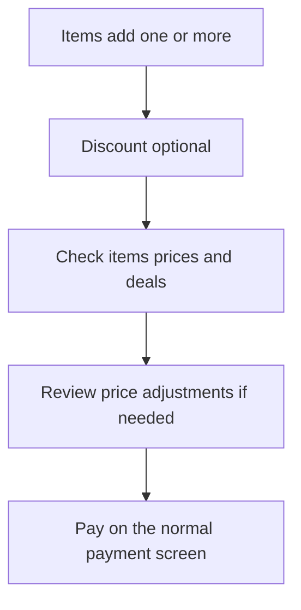

Guided checkout gives the cashier one step at a time: **Items**, **Discount**, **Check** and **Pay**. It is used by **Minimal** mode and can be switched on for **Custom** mode. Adding a customer is optional and does not interrupt the default flow.

## Basic

### Take a sale through the steps
1. **Items**: tap or scan the products. Add at least one item before pressing **Next**.
2. **Discount**: deals are applied automatically. Add a voucher or special price if needed, or tap **No, carry on**.
3. **Check**: review the items and total with the customer. Tap an item to change or remove it, then tap **Looks right**.
4. **Pay**: tap **Take payment**. Choose card, cash, gift card or a mix on the usual payment screen.

The progress bar shows which step you are on. Use **Back** to return to an earlier step.

### More options
Tap **More options** at the top to add or change a customer, add a custom amount, sell a gift card, check whether the drawer can make change, save or open a saved cart, or start again. Starting again clears the cart after confirmation.

## Deep

### The steps are prompts, not new sale rules
Guided checkout uses the same cart, prices, discounts, customer and payment flows as the regular Checkout screen. It does not change how a sale is calculated or recorded.

The Discount step is optional. Customer selection is available from **More options**; Custom mode can enable a separate Customer step. A new empty cart returns to **Items**. If a sale has already taken a part payment, the flow resumes at **Pay**; the part-paid sale cannot be edited until payment is finished.

### Checks before payment
The **Check** step shows the cart and any bundle combinations that need a customer check. If the cart has a price adjustment requiring confirmation, that review appears before the payment screen. The cashier still gets the deal even when a bundle is not a recommended pair.

## Advanced

### Flow

| Job | Where |
|---|---|
| Guided screen and More options | `src/screens/GuidedCheckout.tsx` |
| Step order, progress and advance rules | `STEPS`, `canAdvance`, `settle` in `src/lib/guidedFlow.ts` |
| Select guided checkout for Minimal or Custom | `guided` in `src/lib/uiMode.ts`, `src/ui/uiProfile.tsx` |
| Guided screen navigation | `src/ui/nav.tsx` |
| Tests | `tests/guidedflow.test.ts` |

When a part payment exists, the cart is locked for editing and the guided flow settles directly on Pay so the cashier can finish the remaining balance.
