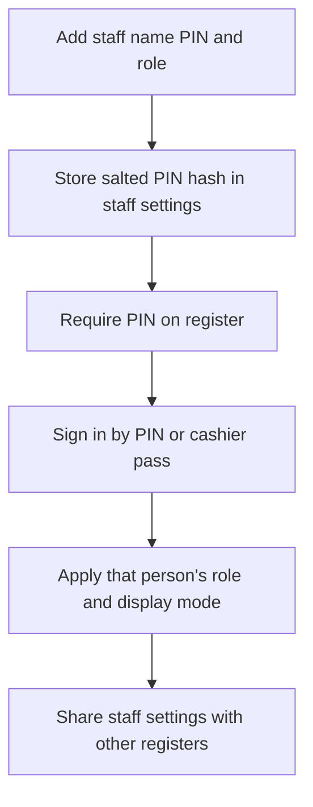

Use **More ▸ Staff** to add the people who use the register, choose their role and set whether the till asks them to sign in. Each person can also have a cashier pass, display mode, appearance, accent colour and tile size.

## Basic

### Add a staff member
1. Tap **Add staff member**.
2. Enter their name and a unique PIN of **4–6 digits**.
3. Choose **Cashier**, **Manager** or **Owner**, then tap **Add**.

PINs must not be shared between staff members. The app stores each PIN as a salted hash and shares the staff list with your other registers.

### Require sign-in
Turn on **Require PIN to use the register** to show the sign-in screen when the register is locked. Add at least one staff member first. To sign in, enter the PIN or scan that person's cashier pass.

You can switch staff from the **Switch staff** sheet without locking the register first. The cart stays as it is. The register will not switch people while a card payment is in progress.

### Change or remove someone
Tap a person's row to open their settings. Choose their display mode, manage their cashier pass, or remove them. Removing someone makes their PIN and pass stop working.

For issuing, printing or cancelling a pass, see [[staff/passes]]. For per-person screen layout and appearance, see [[staff/modes]].

## Deep

### What roles control
- **Cashier** accounts do not see **Reports**, **Staff** or **Settings** while staff sign-in is required.
- **Manager** and **Owner** accounts can see those More menu entries.
- Display modes can hide menu entries, but never add access that a role does not have.
- Without staff sign-in enabled, the till acts as the owner for role-gated functions.

The Staff screen also has role switches for who may set item, line and whole-order price adjustments. Owners cannot be restricted. Managers or owners can change those switches; a manager can do so when the team has no owner account.

### Staff settings are shared
PIN hashes, roles, passes, display modes and personal appearance preferences travel with the shared staff settings. A pass's scannable code is kept only on the iPad that issued it; other registers can recognise it from its hash but cannot reprint its code.

## Advanced

### Staff and sign-in flow

| Job | Where |
|---|---|
| Add/remove staff and select role | `src/screens/Staff.tsx` |
| PIN hashing and verification | `hashPin`, `verifyPin` in `src/lib/pin.ts` |
| Sign-in, switching and register locking | `src/lib/staffAuth.ts` |
| Role-gated More entries | `visibleMoreRows` in `src/lib/uiMode.ts`, `src/screens/More.tsx` |
| Price-adjustment role rules | `src/lib/adjustPerms.ts` |
| Staff record | `StaffMember` in `src/lib/types.ts` |
| Shared staff settings | `pushSharedSettings` in `src/lib/sync.ts` |

Changing staff or sign-in settings updates the local settings immediately. If upload fails, the register keeps the change pending and retries while the app is open; other online registers receive it on their next poll after the upload succeeds.
