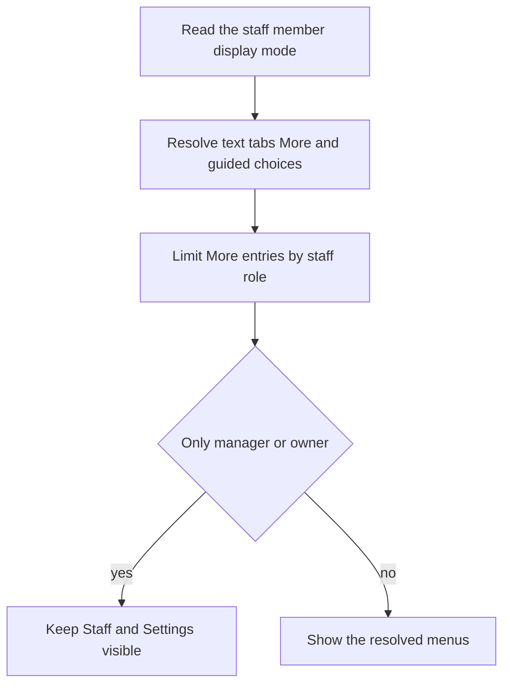

Each staff member has a display mode and personal appearance preferences, set from their row in **More ▸ Staff**. These change how the POS looks for them, not their role permissions.

## Basic

### Choose a mode
- **Standard** shows the full app in its usual layout.
- **Simple** keeps the same features, with plain-English explanations in the More menu.
- **Minimal** uses fewer tabs and More entries, and asks one checkout question at a time.
- **Custom** lets you choose text size, tabs, each More entry, explanations and guided checkout separately.

Tap the staff member's row in Staff, select a mode under **Display mode**, then close the sheet. Each person's choice follows their staff record to the other registers.

### Custom choices
In **Custom**, choose **Normal**, **Large** or **Extra large** text; turn plain-English lines under More entries on or off; choose tab and More-menu presets, then override each tab and More entry individually; and turn **Guided steps** on or off. When guided steps are on, a separate switch can add the optional Customer step. Checkout and More tabs stay visible.

See [[staff/guided-checkout]] for what happens in that flow.

### Personal appearance
Under **Personal display preferences**, choose **Register** to inherit the current iPad's setting, or choose **Brand**, **Light**, **Dark** or **System**. Personal tile size and accent can also override the register defaults. These choices follow the staff member to other registers.

## Deep

### Tabs and More entries
- **All** tabs shows Checkout, Inventory, Transactions, Notifications and More.
- **No alerts** removes only the Notifications tab.
- **Basic** shows Checkout, Transactions and More.
- **All** More entries means everything the person's role allows. **Everyday** adds Items and Customers to the essential entries. **Essentials** keeps Orders, Saved carts, Gift cards, Cash drawer, Support & diagnostics, Help and Lock register, subject to role access.

Cashiers do not get manager-only entries such as Reports, Staff and Settings when staff sign-in is required. A display mode cannot grant them those entries. Checkout and More stay available so the person can do their job and get back to other parts of the app.

### The sole-admin safeguard
If the only Manager or Owner selects a mode that hides Staff or Settings, the POS shows those entries anyway. This prevents the only administrator from losing the controls needed to change the mode back.

Changing to **Custom** starts from the mode the person was using, so its text size and menu choices carry over until you change them.

## Advanced

### Mode resolution

| Job | Where |
|---|---|
| Mode data, presets and resolution | `src/lib/uiMode.ts` |
| Edit a staff member's mode | `src/screens/Staff.tsx` |
| Apply text sizing and tab profile | `src/ui/uiProfile.tsx` |
| Role and mode filtering in More | `visibleMoreRows` in `src/lib/uiMode.ts`, `src/screens/More.tsx` |
| Read a staff member's current mode | `src/ui/uiProfile.tsx` |
| Apply personal theme and accent | `src/ui/theme.tsx` |
| Apply personal Checkout tile size | `src/screens/Tiles.tsx` |

The modes are display preferences, not security roles. The role check is applied separately after a mode chooses which More entries to show.
