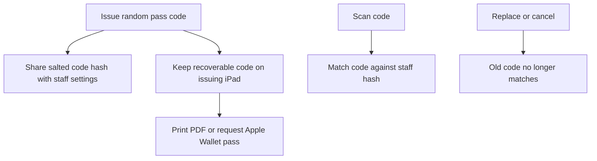

A cashier pass is a scannable alternative to typing a staff member's PIN. Issue it from **More ▸ Staff**, then print it, save or share a PDF, or send it to Apple Wallet.

## Basic

### Issue and use a pass
1. In **More ▸ Staff**, tap the person and choose **Cashier pass**.
2. Tap **Issue pass**. Choose **QR code** or **Code 128** for a standard shop barcode scanner.
3. Print the pass, save/share the PDF, or send it to Apple Wallet.
4. On the sign-in screen or **Switch staff** sheet, scan the pass with a Bluetooth scanner. You can also tap **Scan pass** to use the camera.

Most Bluetooth scanners and the camera can read the QR code. Choose Code 128 if your scanner only reads standard shop barcodes. A PIN remains available as another way to sign in.

### Replace or cancel a pass
**Replace pass** creates a new code and immediately disables the old one. Any printed copy or Wallet pass with the old code must be replaced. **Cancel pass** disables it; the staff member can still sign in with their PIN.

### Apple Wallet
Sending to Apple Wallet needs the pass server link and secret configured in **Settings ▸ Gift cards**. The app creates the Wallet pass, then opens the iPad's share sheet so you can send it to the staff member's iPhone. They tap **Add** there.

## Deep

### If this iPad no longer has the code
The pass code is saved only on the iPad that issued it. The shared staff list contains a hash, which lets other registers verify scans but cannot recover or print the original code. If the issuing iPad has lost its saved copy, choose **Replace pass** on a register with the staff list; the old code will stop working and the new code can be printed or sent from that iPad.

Scanning a pass signs the person in or takes over from the currently signed-in staff member. The cart stays in place. Switching is blocked while a card payment is waiting on the reader; finish the payment first.

## Advanced

### Pass lifecycle

| Job | Where |
|---|---|
| Issue, replace, cancel, print and share | `StaffPassSheet` in `src/screens/StaffPass.tsx` |
| Hash and match pass codes | `src/lib/badge.ts` |
| Keep the issuing iPad's copy | `src/lib/badgeStore.ts` |
| PIN/pass sign-in and switching | `src/lib/staffAuth.ts` |
| Camera and HID scanners | `CameraScanner`, `HidScanner` in `src/screens/Scanner.tsx` |
| Create an Apple Wallet pass | `requestStaffPass` in `src/lib/passUrl.ts` |

Wallet pass creation requires the separately configured pass server. Printing and PDF sharing use the iPad's print/share interfaces; those options do not require Wallet setup.
