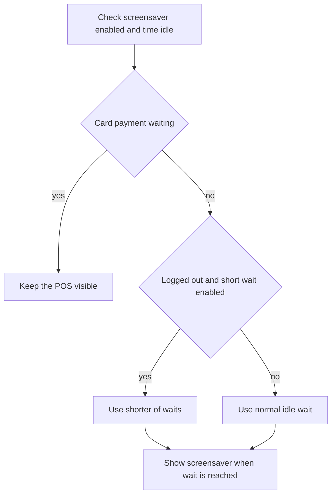

Open **More ▸ Settings ▸ Screensaver & display** to stop the iPad sleeping or show a logo screen when the register is idle. These choices are for this iPad, not a staff member's display mode.

## Basic

### Keep the iPad awake
Turn on **Keep iPad awake** to stop iOS from auto-locking or dimming while the POS is open. This is separate from the Screensaver switch. The app recommends leaving it on for a till and keeping the iPad plugged in.

### Show an idle screen
Turn on **Screensaver**, then choose **Show after** 1, 2, 5, 10 or 30 minutes. It shows a logo on a background colour; if there is no usable logo, it shows the shop name or **Point of sale**.

Tap the screen once to wake it. If the register was locked, waking the screen does not sign anyone in; use the PIN or cashier pass on the sign-in screen.

### Set a logo
Use **Logo link (https)** for a secure image URL, or tap **Upload an image from Files…**. PNG and JPG are supported; SVG files are not. An uploaded logo is stored on this iPad. You can choose a background swatch or enter a three- or six-digit hex colour, then tap **Preview full screen**.

## Deep

### Logged-out timing and other options
- **Show when logged out** uses a shorter wait on the PIN screen. Choose **Logged-out wait** of 5, 15, 30 or 60 seconds.
- **Slowly move the logo** drifts the image around the screen. **Show the time** adds a clock.
- When the register is logged out and the shorter wait is enabled, the screensaver uses the shorter of the logged-out wait and normal idle time.
- It never covers the screen while a card payment is waiting on the reader.

The idle timer resets when someone touches the app, types or scans. The screensaver and Keep iPad awake settings belong to this device; they do not follow the staff member to another register.

## Advanced

### Idle screen rules

| Job | Where |
|---|---|
| Screensaver timing and UI | `src/ui/Screensaver.tsx` |
| Idle timer | `idleMs`, `noteActivity` in `src/lib/idle.ts` |
| Show timing, colours and logo source | `shouldShowScreensaver`, `normaliseHex`, `logoSource` in `src/lib/screensaver.ts` |
| Screensaver settings panel | `DisplaySettings` in `src/screens/Settings.tsx` |
| Per-device settings default | `screensaver` in `src/state/store.ts` |
| Tests | `tests/screensaver.test.ts` |

The Screensaver switch is off by default. **Keep iPad awake** is on by default. A card payment waiting on the reader suppresses the screensaver even when the idle time has elapsed.
