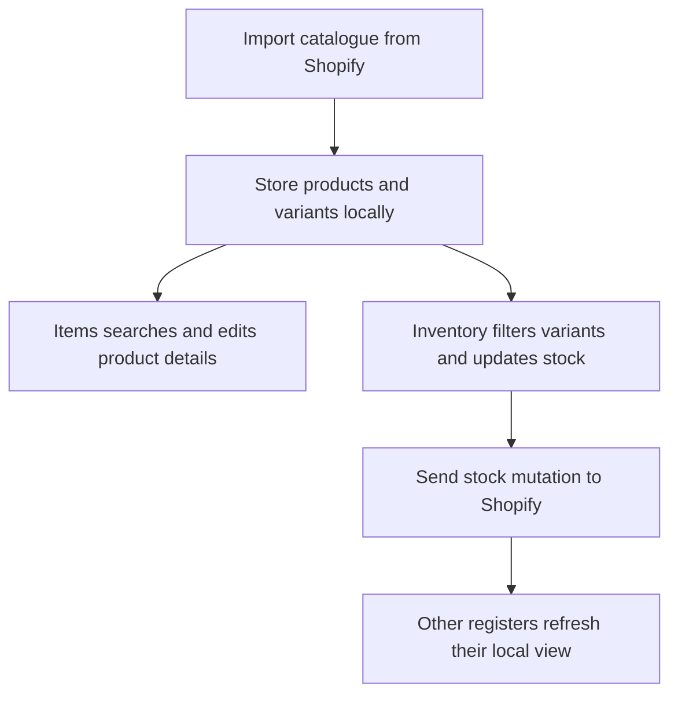

Shopify is the shared product catalogue. **Items** is for finding and editing product details; **Inventory** is for checking and changing stock counts.

## Basic

### Choose the right screen
- Open **More ▸ Items** to search products and variations, change price, SKU, barcode or cost, or create an item.
- Open the **Inventory** tab to see stock, filter the catalogue, and receive, adjust or count quantities.
- A product can have several variations. Each variation has its own price, SKU, barcode and stock count.

For stock words and what happens when sales or refunds change a count, see [[sales/variants-and-stock]]. For Inventory filters, grouping and stock updates, see [[stock/inventory]]. For catalogue editing and creating an item, see [[stock/items]].

### If an item is missing
Import or refresh from Shopify in **More ▸ Settings ▸ Shopify**. Inventory can include active, unlisted, draft and archived products, but its default status filter is **Active**, which also shows **Unlisted** products (they are still for sale). Draft and archived products are never sold from the till. Use Filters to include other statuses. When counts still differ, use **Refresh stock from Shopify** in Inventory.

## Deep

### Products and variations
A Shopify product may contain one or more variants. The Items list has one row for each variant, even when product names repeat. Inventory can show every variant as a flat list or group variants under a product. Changing an item's price or identifiers in this POS saves to Shopify; stock counts are changed from Inventory.

### What is stored locally
The app imports product/variant details and the selected location's available stock into its local catalogue. It refreshes the catalogue from Shopify on request and receives shared stock changes while open. Each register updates its own local view, while Shopify remains the shared source.

## Advanced

### Catalogue and stock flow

| Job | Where |
|---|---|
| Catalogue type | `Variant` in `src/lib/types.ts` |
| Bulk catalogue import | `fetchVariants`, `fetchCollections` in `src/lib/shopify/catalogue.ts` |
| Items list and editor | `ItemsList`, `EditItem` in `src/screens/Items.tsx` |
| Inventory list and count UI | `src/screens/Inventory.tsx` |
| Stock updates | `setStock`, `adjustStock` in `src/lib/shopify/inventory.ts` |
| Search, filters and grouping | `src/lib/inventoryView.ts` |

`Variant.stock` is a number when tracked and `null` when not tracked. A negative number means Shopify has recorded more sales than available stock, not that the value is missing.
