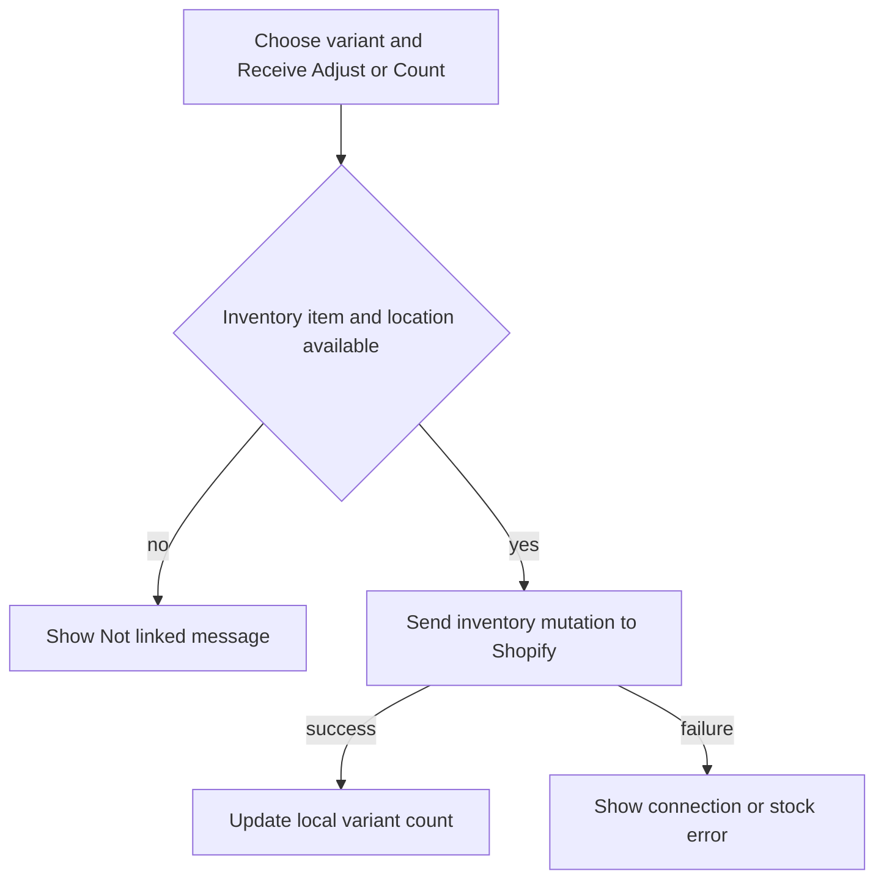

The **Inventory** tab shows stock for the catalogue on this iPad. Search or filter to find a variation, then tap it to receive stock, make an adjustment, or set a counted quantity.

## Basic

### Find an item
Search by product name, variation, SKU or barcode. Use the quick chips for **All**, **Low**, **Out (0)** and **Negative**. **Filters** opens the full options:
- **Category**: all categories or one Shopify collection.
- **Stock level**: All, Low, Out (0), Negative, Tracked or Not tracked.
- **Low** threshold: choose 1, 2, 3, 5 or 10 when Low is selected.
- **Product status**: Active, Draft, Archived or All. **Active** includes products marked **Unlisted** in Shopify, which show *unlisted* under their name; Draft and Archived do not.
- **Sort by**: name, stock low/high first, price low/high first, or recently updated.
- **Show variations**: each variant on its own, or **Nested under item**.

The header shows matching variant and product counts. In nested view, tap a product row to expand or collapse its variations. Searching expands matching groups automatically.

### Change a stock count
Tap a variant row. Choose:
- **Receive** to add the quantity that arrived.
- **Adjust** to add or remove stock. Choose Add/Remove and a reason such as correction, damaged or shrinkage.
- **Count** to enter the actual quantity you counted; this replaces the old number.

Enter a whole number and tap **Apply** or **Set stock to …**. The POS sends the change to Shopify and updates this register's catalogue after success. A missing inventory link or location prevents the update; choose a Shopify location or import the item again.

### Refresh and saved choices
Tap **Refresh stock from Shopify** at the bottom to import the catalogue again. The Filters sheet shows the total variants on this device and the last import time, so you can compare it with Shopify. Filter, sort, grouping and low-threshold preferences are remembered on this iPad.

## Deep

### What the filters mean
- **Low** includes tracked counts from zero through the chosen threshold.
- **Out (0)** means exactly zero. **Negative** means less than zero.
- **Tracked** includes any count, including negative. **Not tracked** has no count and is not the same as zero.
- A category filter uses the selected Shopify collection. Products can appear in more than one collection.
- By default the screen filters to **Active** products (Active and Unlisted in Shopify). Draft and archived variants remain in the local catalogue, but are hidden until the status is changed.

The app's default low threshold is 2 and default sort is Stock: low first. Changing to nested or flat view does not change the underlying stock.

### Product groups
Nested groups show a product title, variation count, combined tracked stock and price range. A product with one variant stays a plain row. Untracked variants do not add a numeric stock; a group with no tracked variants shows a dash. The group total can be negative if its tracked variants sum below zero.

### If the catalogue count is lower than Shopify
Tap **Refresh stock from Shopify** and compare the total variant count and import time shown in Filters. The catalogue import uses Shopify's bulk product-variant query and the selected location. Draft and archived status filters can hide rows, but the device total in the Filters sheet counts the entire local catalogue.

If the same variant still differs from Shopify, check the selected location, tracked setting and **available** quantity in [[fix/stock-mismatch]].

## Advanced

### Stock update path

| Job | Where |
|---|---|
| Inventory list, sheets and refresh | `src/screens/Inventory.tsx` |
| Filter, sort, grouping and rows | `filterVariants`, `sortVariants`, `groupVariants`, `buildRows` in `src/lib/inventoryView.ts` |
| Set exact count | `setStock` in `src/lib/shopify/inventory.ts` |
| Receive or adjust | `adjustStock` in `src/lib/shopify/inventory.ts` |
| Saved Inventory preferences | `inventory` in `src/state/store.ts` |
| Tests | `tests/inventory.test.ts` |

The filter/search is applied before grouping. The list has no fixed row cap. In stock-ascending or stock-descending order, untracked variants always sort last. When grouped, group ordering uses total tracked stock, the lowest price, or latest update, depending on the selected sort.
