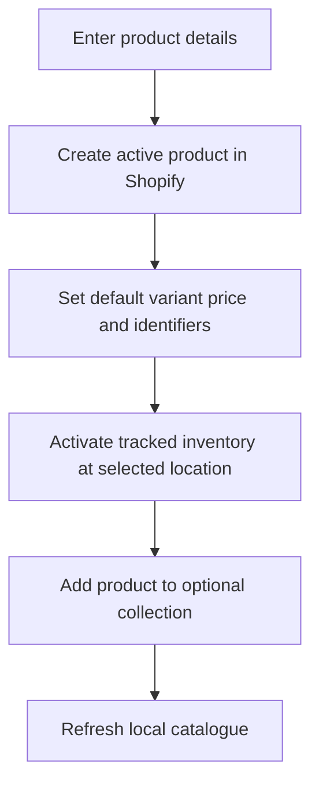

The **Items** screen is the catalogue editor. It lists variants and lets you change a variant's price, SKU, barcode and cost, or create a new product.

## Basic

### Find or edit a variant
Open **More ▸ Items** and search by product name, variant, SKU or barcode. Tap a row to edit it. Change **Price**, **SKU**, **Barcode** or **Cost**, then tap **Save to Shopify**. Cost is used for profit reporting. Use **Inventory** to receive stock, adjust it or enter a stock count: [[stock/inventory]].

### Create an item
1. In Items, tap **+** and choose a name and price. Both are required.
2. Add a SKU, barcode and cost if you use them.
3. If offered, enter **Starting stock** and choose a category.
4. Tap **Create item**. The app needs a Shopify location and an internet connection.

The new product is created in Shopify, then the app imports the catalogue again. New products are tracked at the selected location. If the create step reports an error, check Shopify and refresh before trying again.

### Price, SKU and barcode
Each variation has its own price and identifiers. A product with multiple variations appears as multiple rows with the same product name. Changing a variant's details does not rename the Shopify product; use Shopify admin for product titles and variant options.

## Deep

### What the create form writes
The form creates an active Shopify product with its default variant, then sets the variant's price, barcode, SKU, cost and inventory tracking. It activates inventory at the selected location and can add the product to one chosen Shopify collection. The app refreshes its local catalogue after creation.

### A known starting-stock issue
The form currently displays **Starting stock**, but the create request does not apply the entered quantity after inventory is activated. New stock therefore needs to be set from **Inventory** after creation. This is recorded as an open follow-up in `docs/PROGRESS.md`; do not rely on the form's Starting stock field until that is fixed.

## Advanced

### Create and edit path

| Job | Where |
|---|---|
| Items list, create and edit forms | `ItemsList`, `CreateItem`, `EditItem` in `src/screens/Items.tsx` |
| Shopify product and variant writes | `createItem`, `updateVariant` in `src/lib/shopify/products.ts` |
| Catalogue refresh after creation | `importFromShopify` in `src/lib/sync.ts` |
| Stock changes | `src/screens/Inventory.tsx`, `src/lib/shopify/inventory.ts` |

`createItem` creates an active product and its default variant, then enables tracked inventory at the selected location. Although the form input type has an optional `stock` field, the current helper does not send that quantity to Shopify.
